<div align="center">

<picture>
  <source media="(prefers-reduced-motion: reduce)" srcset="assets/banner-static.svg">
  
</picture>

<br/>

<!-- identity -->



<br/>

<!-- stack -->
<a href="https://react.dev"></a>
<a href="https://www.typescriptlang.org"></a>
<a href="https://vite.dev"></a>


<br/>

<!-- platform -->


<br/><br/>

*The original Pac-Man maze and ghost rules, redrawn in thin gold line and built for one thumb. Swipe anywhere, play on any phone, host it anywhere.*

<br/>

[Overview](#overview) &nbsp;·&nbsp; [Screens](#screens) &nbsp;·&nbsp; [Features](#features) &nbsp;·&nbsp; [The maze](#the-maze) &nbsp;·&nbsp; [Ghosts](#ghosts) &nbsp;·&nbsp; [Steering](#steering) &nbsp;·&nbsp; [Difficulty](#difficulty) &nbsp;·&nbsp; [Architecture](#architecture) &nbsp;·&nbsp; [Getting started](#getting-started) &nbsp;·&nbsp; [Deployment](#deployment) &nbsp;·&nbsp; [Credits](#credits)

</div>

---

<a id="overview"></a>
##  Overview

**Aurum Maze** is a browser Pac-Man built mobile first. It plays the real Midway layout for 255 rounds, follows the arcade difficulty tables, and ends on the split screen of round 256. Everything around the maze is new: a gold line look, one screen per view, thumb sized controls and a swipe anywhere steering model.

- **One board, 255 rounds.** The same 28 by 31 maze repeats, while speeds, frightened time, ghost waves, fruit and house rules change round by round.
- **Real ghost behaviour.** Blinky, Pinky, Inky and Clyde each pick a target tile the way the arcade ghosts do, and decide only at tile centres.
- **Built for touch.** Swipe anywhere, turns that forgive early or late input, instant reverse, and an optional D-pad.
- **Static and private.** No backend, no account, no tracking. Progress lives in `localStorage` on your device.

<div align="center">


</div>

---

<a id="screens"></a>
##  Screens

| Screen | Purpose | Mobile decisions |
|---|---|---|
| **Home** | Title, best score, one large Play button | Everything fits one screen, no scrolling. Secondary actions are one tap away |
| **Play** | The game | Maze uses the full screen width. Lives, ghost moods and fruit sit directly below it |
| **Rounds** | Pick any unlocked round | Twenty rounds per page in a four by five grid, each with its fruit |
| **Ghosts** | Learn how each ghost hunts | One ghost per screen. Swipe sideways, tap a face to jump |
| **Pause** | Controls, sound, haptics, exit | A bottom sheet in the thumb zone |

---

<a id="features"></a>
##  Features

<table>
<tr>
<td width="50%" valign="top">

 **Faithful maze**
- Real 28 by 31 Midway board
- 240 dots and 4 power pellets
- Two tile ghost house gate
- Wrapping side tunnel
- Round 256 split screen

</td>
<td width="50%" valign="top">

 **Arcade ghost AI**
- Four distinct target rules
- Scatter and chase waves
- One forced reversal per wave and per power pellet
- Four no-up intersections
- Cruise Elroy speed up for Blinky

</td>
</tr>
<tr>
<td width="50%" valign="top">

 **Touch first controls**
- Swipe anywhere, chain swipes
- 0.55 tile turn window
- 0.7 s turn buffer
- Instant reverse
- Optional D-pad that fires on press

</td>
<td width="50%" valign="top">

 **Scoring and progress**
- Fruit after 70 and 170 dots
- Ghost chain 200, 400, 800, 1600
- 12,000 bonus for all sixteen ghosts
- Extra life at 10,000
- Best score and unlocked rounds saved

</td>
</tr>
<tr>
<td width="50%" valign="top">

 **Gold line design**
- Thin glowing walls, wide corridors
- Pac-Man and ghosts drawn at about 1.3 tiles
- Warm black surface, ivory text, gold accents
- Fruit and ghost art as shared vectors

</td>
<td width="50%" valign="top">

 **Sound and feel**
- Synthesised effects, no audio files
- Unlocked on the first swipe for iOS
- Haptics on supported devices
- Auto pause when the app is hidden

</td>
</tr>
</table>

---

<a id="the-maze"></a>
##  The maze

<div align="center">


</div>

| Item | Value |
|---|---|
| Size | 28 columns by 31 rows |
| Dots | 240 pellets and 4 power pellets, 244 in total |
| Ghost house | Two tile gate on row 12, scripted exit and return |
| Tunnel | Row 14, wraps left to right, slows ghosts |
| Fruit | Below the house, 9.5 seconds, after 70 and 170 dots |
| Pac-Man start | Centre line of row 23 |
| Round 256 | The right half of the board turns to corrupted glyphs, as in the arcade |

The layout lives in `src/game/arcadeMaze.ts` as plain text rows. Walls are traced into outlines at runtime and drawn as rounded gold lines, so the board looks light even though the collision grid is the original tile map.

---

<a id="ghosts"></a>
##  Ghosts

<div align="center">


</div>

| Ghost | Role | Chase target | Scatter corner | Leaves the house |
|---|---|---|---|---|
| **Blinky** | The Chaser | Pac-Man's tile | Top right | Starts outside |
| **Pinky** | The Ambusher | 4 tiles ahead of Pac-Man (facing up also shifts 4 left) | Top left | At once |
| **Inky** | The Flanker | Vector from Blinky to 2 tiles ahead of Pac-Man, doubled | Bottom right | After 30 dots on round 1 |
| **Clyde** | The Shy One | Pac-Man, or his corner inside 8 tiles | Bottom left | After 60 dots on round 1 |

**Shared rules.** Ghosts decide only at tile centres, never reverse by choice, pick the exit whose next tile is closest to the target, and break ties in the order up, left, down, right. Frightened ghosts wander at random. Eaten ghosts return as eyes and leave again at once.

**House release.** Each ghost has a personal dot counter. After a death a global counter of 7, 17 and 32 dots takes over. If you stop eating, an idle timer of 4 seconds (3 from round 5) pushes the next ghost out.

---

<a id="steering"></a>
##  Steering

<div align="center">


</div>

Pac-Man keeps moving until a wall stops him, exactly as in the arcade. Input only steers.

- **Turn window.** A perpendicular turn is accepted up to 0.55 tile before or after the junction centre. The sprite eases onto the new line so there is no visible jump.
- **Turn buffer.** A swipe made earlier is remembered for 0.7 seconds and taken at the next legal junction.
- **Instant reverse.** The opposite direction is applied at once, anywhere.
- **Eating costs time.** Pac-Man pauses one frame per dot and three per power pellet, as in the arcade.
- **Forgiving collisions.** A ghost catches you at 0.55 tile, while you catch a frightened ghost at 0.8 tile.

---

<a id="difficulty"></a>
##  Difficulty

<div align="center">


</div>

All values come from the arcade tables in `src/game/difficulty.ts`.

| Round band | Pac-Man | Ghost | Tunnel | Frightened ghost | Wave pattern |
|---|---|---|---|---|---|
| 1 | 80% | 75% | 40% | 50% | 7, 20, 7, 20, 5, 20, 5, then chase |
| 2 to 4 | 90% | 85% | 45% | 55% | 7, 20, 7, 20, 5, then a long chase |
| 5 to 20 | 100% | 95% | 50% | 60% | 5, 20, 5, 20, 5, then a long chase |
| 21 and up | 90% | 95% | 50% | 60% | Same as 5 to 20, no frightened time |

`BASE_SPEED` is 8.5 tiles per second for a 100% step. The cabinet runs near 9.5, so Aurum Maze plays at about 90% of arcade pace to give a thumb the same reaction margin a joystick has. It is the single dial for overall speed.

---

<a id="architecture"></a>
##  Architecture

<div align="center">


</div>

The engine in `src/game` has no React inside it. React owns screens and settings, the engine owns the run, and the canvas renderer reads engine state every frame.

<div align="center">


</div>

- **Fixed step.** The simulation advances in 1/120 second ticks. A slow frame runs several ticks, a fast frame runs none, so speed never depends on the display.
- **Tile centre movement.** Entities hold continuous tile coordinates and make decisions only on tile centres, which keeps every actor on the corridor grid.
- **Cached scenery.** Walls and the gate are painted once to an offscreen canvas. Only pellets, fruit, actors and popups are drawn per frame.
- **Few React updates.** The engine emits a HUD snapshot only when a visible value changes.
- **No audio files.** `Sfx.ts` builds every effect with oscillators and unlocks audio on the first swipe.

### Project structure

```
src/
  game/          engine, no React
    GameEngine.ts    run state, rules, fixed step
    Maze.ts          tiles, pellets, tunnel
    Entity.ts        tile centre movement
    PacMan.ts        turn window, buffer, reverse
    Ghost.ts         shared ghost rules
    ghosts/          Blinky, Pinky, Inky, Clyde
    difficulty.ts    arcade tables, BASE_SPEED
    Renderer.ts      gold line canvas renderer
    InputManager.ts  swipe and keyboard
    Sfx.ts           Web Audio synth
    Progress.ts      saves and settings
    arcadeMaze.ts    the 28 by 31 board
    fruitArt.ts      fruit vectors, shared with the UI
  components/    Hud, GhostTray, PauseSheet, Sheet, TabBar, GhostDiagram, ...
  views/         HomeView, PlayView, LevelsView, GhostsView
  router.ts      hash routes: #/, #/ghosts, #/levels, #/play/N
scripts/
  verify.ts      headless checks
assets/          README artwork: banner, badges, icons, diagrams
```

---

<a id="getting-started"></a>
##  Getting started

**Prerequisites:** Node.js 20 or later, and npm.

```bash
git clone https://github.com/<your-user>/aurumMaze.git
cd aurumMaze
npm install
npm run dev
```

Open the address Vite prints. The base path is `/aurumMaze/`, so locally the game is at `http://localhost:5173/aurumMaze/`.

| Command | What it does |
|---|---|
| `npm run dev` | Start the dev server with hot reload |
| `npm run build` | Type-check with `tsc -b`, then build to `dist/` |
| `npm run preview` | Serve the production build locally |
| `npm run lint` | Type-check only |
| `npm run verify` | Run the headless engine checks |

### Controls

| Input | Action |
|---|---|
| Swipe anywhere | Steer, chain swipes without lifting |
| Arrow keys or WASD | Steer on a keyboard |
| Space, P or Esc | Pause and resume |
| Pause sheet | Switch to D-pad, toggle sound and haptics |

### Verification

`npm run verify` runs without a browser and checks that:

- the maze is 28 by 31, left and right symmetric, fully connected, with 244 dots and a two tile gate
- Pac-Man steers, reverses instantly, wraps through the tunnel and never leaves the corridor grid
- an eaten ghost finds the ghost house from every tile of the maze
- five random soak runs keep every ghost on valid corridors, including round 256
- the speed, frightened time, house limit and fruit tables match the arcade

### Saved data

Progress, best score and options are stored in `localStorage` under `aurum-maze:v2`. Clearing site data resets the game.

---

<a id="deployment"></a>
##  Deployment

<div align="center">


</div>

`.github/workflows/deploy.yml` runs on every push to `main` and on manual dispatch. It installs with `npm ci`, runs `npm run build`, uploads `dist/` and deploys it to GitHub Pages.

> **Note:** `base` in `vite.config.ts` is `/aurumMaze/` and must match the repository name. In the repository settings, set Pages to deploy from GitHub Actions.

---

<a id="accuracy"></a>
##  Accuracy

The maze and rules follow the 1980 Midway arcade game. This is a browser reimplementation, not a frame accurate emulator. Sub-pixel movement, cornering, sound, the arcade's pseudo-random frightened turns and the exact corrupted screen differ from the hardware. Turns are deliberately more forgiving than a joystick, and overall pace is set to about 90% of the cabinet.

<a id="credits"></a>
##  Credits

| Reference | Used for |
|---|---|
| [The Pac-Man Dossier](https://pacman.holenet.info/) | Ghost targeting, speed and timing tables, release rules |
| [bielesibub/pacman](https://github.com/bielesibub/pacman) | ROM derived tile data that the maze was first decoded from. The layout was then corrected and verified against the arcade board |
| [Woodland Chess](https://github.com/woodlandChess/woodlandChess.github.io) | Inspiration for this README artwork: animated banner, pill badges, drawing icons and diagrams |

Pac-Man is a trademark of Bandai Namco. Aurum Maze is an independent fan project.

##  License

All rights reserved. This is a private project and no license is granted for use, copying, modification or distribution. See `LICENSE`.

---

<div align="center">

<br/>


</div>
